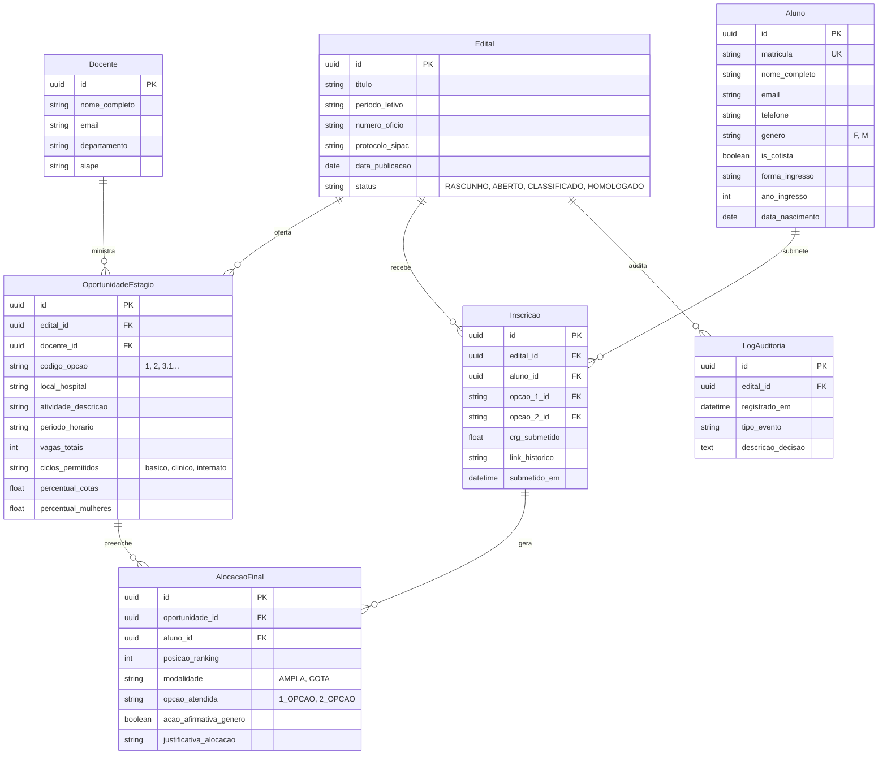

# Arquitetura e Tecnologias Recomendadas: Sistema de Gestão de Estágios FAMED/UFPA

Este documento estabelece as diretrizes arquiteturais, o modelo de dados, as práticas de segurança (LGPD) e o plano de implantação institucional para o sistema de triagem e classificação de estágios da Faculdade de Medicina da Universidade Federal do Pará (FAMED/UFPA).

---

## 1. Visão Geral e Princípios de Design

O sistema tem como objetivo automatizar e dar transparência jurídica ao processo de seleção dos estágios de férias e extracurriculares da FAMED, eliminando o processamento manual de planilhas e reduzindo a zero o risco de erros de desempate, cotas e gênero.

### Princípios Norteadores:
1. **Soberania e Manutenibilidade Institucional:** Utilização exclusiva de tecnologias de código aberto, consolidadas no setor público e dominadas pela equipe do Centro de Tecnologia da Informação e Comunicação (CTIC/UFPA).
2. **Conformidade com a LGPD (Lei 13.709/2018):** Proteção integral aos dados sensíveis dos estudantes (notas, históricos acadêmicos, laudos PCD, condições socioeconômicas e contatos).
3. **Auditoria e Rastreabilidade Completa:** Todas as decisões (notas comparadas, critérios de desempate, substituições afirmativas de gênero e reversões de cotas) são registradas com logs imutáveis.
4. **Deploy Simplificado via Docker:** Empacotamento pronto para subida rápida em servidores Linux institucionais.

---

## 2. Pilha Tecnológica Selecionada

```
+-------------------------------------------------------------------+
|                        FRONTEND (UI)                              |
|          HTML5 semântico + CSS3 (Tailwind CSS) + HTMX 2.x         |
|      (Interatividade reativa com baixa complexidade e sem SPA)    |
+-------------------------------------------------------------------+
                                  |
                                  v
+-------------------------------------------------------------------+
|                      BACKEND / CONTROLLER                         |
|            Python 3.12+ / Django 5.x (Monolítico Robusto)         |
|   - Django Admin (Gestão de Usuários, Permissões RBAC e Grupos)   |
|   - ORM Django (Migrações versionadas e consultas otimizadas)     |
|   - Autenticação e Sessões Seguras                                |
+-------------------------------------------------------------------+
             |                                              |
             v                                              v
+-----------------------------+             +-------------------------------+
|     MOTOR DE CLASSIFICAÇÃO  |             |      BANCO DE DADOS           |
|      (classificador.py)     |             |      PostgreSQL 16            |
| - Pandas / NumPy            |             | - Histórico de Editais        |
| - Heurística Censo IBGE     |             | - Candidatos e Inscrições     |
| - ReportLab (Geração PDF)   |             | - Trilha Imutável de Auditoria|
+-----------------------------+             +-------------------------------+
                                  |
                                  v
+-------------------------------------------------------------------+
|                     HOSPEDAGEM E DEPLOY                           |
|      Docker + Docker Compose + Gunicorn + Nginx Reverse Proxy     |
+-------------------------------------------------------------------+
```

### Justificativas das Escolhas:
* **Backend (Django):** Framework Python com mais de 15 anos de maturidade. Oferece nativamente proteção contra CSRF, SQL Injection, Clickjacking, além de um painel administrativo completo (`django-admin`) pronto para uso pelos coordenadores da FAMED.
* **Frontend (HTMX + Tailwind CSS):** Permite construir interfaces dinâmicas e reativas diretamente com requisições HTTP parciais, sem a sobrecarga de gerenciar pipelines complexos de compilação frontend (Node, npm, Webpack) ou complexidades de sincronização de estado com React.
* **Banco de Dados (PostgreSQL 16):** Banco relacional padrão no CTIC-UFPA, transacional, robusto para integridade referencial e auditoria.
* **Motor Numérico e PDF (Pandas + ReportLab):** Processamento eficiente de planilhas de grande porte e renderização tipográfica precisa dos ofícios oficiais em PDF com Brasão da República.

---

## 3. Modelo de Dados Relacional (PostgreSQL)

O esquema relacional é projetado para manter o histórico de editais e auditoria perpétua:



---

## 4. Segurança da Informação e Conformidade com a LGPD

O tratamento de dados de estudantes de medicina envolve informações qualificadas como pessoais e sensíveis:

1. **Minimização de Dados (Art. 6º, III da LGPD):**
   * Coleta apenas dos dados estritamente necessários para o cálculo e homologação da classificação (Nome, Matrícula, E-mail, Contato, CRG, Histórico e Forma de Ingresso).
2. **Controle de Acesso Baseado em Papéis (RBAC):**
   * **Administrador Geral (CTIC):** Gestão de infraestrutura e backups. Sem acesso a notas.
   * **Comissão de Seleção (Docentes FAMED):** Acesso à homologação e geração de relatórios.
   * **Visualizador Público / Alunos:** Apenas consulta ao resultado final homologado, sem exposição de dados de contato de terceiros.
3. **Ofuscação de Dados Pessoais em Relatórios Públicos:**
   * O ofício gerado para a GEP/HUJBB contém os contatos dos selecionados necessários para a recepção dos alunos nos hospitais. Relatórios gerais abertos na web mascaram matrículas (`20230974####`) e suprimem telefones/e-mails de alunos não selecionados.
4. **Trilha de Auditoria Imutável:**
   * Toda troca efetuada pelo algoritmo (ex: aplicação do percentual de 50% de mulheres ou reversão de cotas) fica registrada na tabela de auditoria com timestamp, nota de origem e regra legal aplicada.

---

## 5. Estrutura de Diretórios para Deploy Institucional

```
estagio_famed/
├── docker-compose.yml          # Orquestração do ambiente completo
├── Dockerfile                  # Build da imagem da aplicação Django
├── .env.example                # Variáveis de ambiente padrão
├── requirements.txt            # Dependências Python (Django, Pandas, ReportLab...)
├── core/                       # Projeto Django
│   ├── settings.py
│   ├── urls.py
│   └── wsgi.py
├── classificacao/              # Aplicação Django de Classificação
│   ├── models.py               # Modelos relacionais (Edital, Oportunidade, Aluno...)
│   ├── views.py                # Views HTMX e endpoints de upload
│   ├── services/
│   │   ├── engine.py           # Motor do classificador.py integrado
│   │   ├── pdf_generator.py    # Geração do Ofício em PDF
│   │   └── cleaner.py          # Higienização de dados e parsers
│   └── templates/              # Templates HTML modernos com Tailwind + HTMX
└── static/                     # Arquivos estáticos (brasao UFPA, CSS, JS)
```

---

## 6. Configuração do Docker Compose de Referência

```yaml
version: '3.8'

services:
  db:
    image: postgres:16-alpine
    container_name: famed_estagio_db
    restart: always
    environment:
      POSTGRES_DB: famed_estagios
      POSTGRES_USER: famed_user
      POSTGRES_PASSWORD: ${DB_PASSWORD:-famed_secret_2026}
    volumes:
      - pgdata:/var/lib/postgresql/data
    networks:
      - famed_net

  web:
    build: .
    container_name: famed_estagio_web
    restart: always
    command: gunicorn core.wsgi:application --bind 0.0.0.0:8000 --workers 3
    volumes:
      - .:/app
      - static_volume:/app/staticfiles
      - media_volume:/app/media
    environment:
      - DATABASE_URL=postgres://famed_user:${DB_PASSWORD:-famed_secret_2026}@db:5432/famed_estagios
      - DJANGO_SECRET_KEY=${DJANGO_SECRET_KEY}
      - DEBUG=False
    depends_on:
      - db
    networks:
      - famed_net

  nginx:
    image: nginx:alpine
    container_name: famed_estagio_nginx
    restart: always
    ports:
      - "80:80"
    volumes:
      - ./nginx.conf:/etc/nginx/conf.d/default.conf:ro
      - static_volume:/app/staticfiles:ro
      - media_volume:/app/media:ro
    depends_on:
      - web
    networks:
      - famed_net

volumes:
  pgdata:
  static_volume:
  media_volume:

networks:
  famed_net:
    driver: bridge
```
